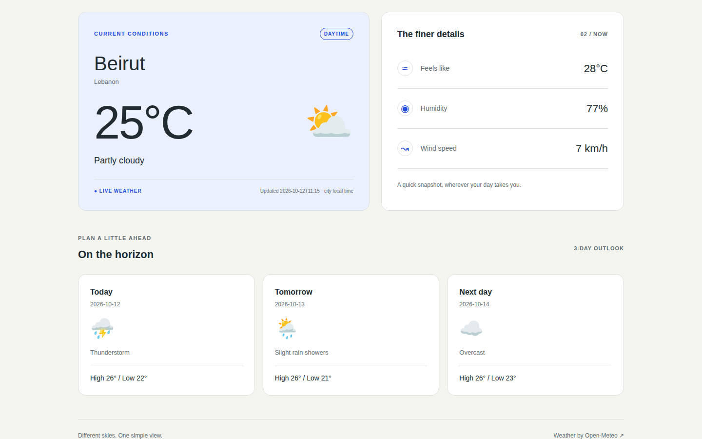

# Atmos | Weather Dashboard

A responsive weather dashboard built with HTML, CSS, and vanilla JavaScript for Assignment 4. Search for a city to view current conditions and a three-day forecast from Open-Meteo.

## Features

- City search using the Search button or Enter, plus quick searches for Beirut, London, and Tokyo.
- Current temperature, weather description, weather icon, and day/night indicator.
- Feels-like temperature, humidity, and wind speed.
- Three-day forecast with weather conditions and daily high/low temperatures.
- Visible loading indicator and disabled search controls during requests.
- User-facing errors for unknown cities, network failures, rate limits, server errors, and incomplete responses.
- Retry button and a 15-second timeout with protection against late responses replacing a newer search.
- Responsive layouts for mobile, tablet, and desktop screens.

## Run locally

You need Python 3, a modern browser with JavaScript enabled, and an internet connection to retrieve weather data. No npm dependencies or build step are required.

1. Clone the repository and enter the project folder:

   ```bash
   git clone https://github.com/JovaniBouKhalil/weather-dashboard.git
   cd weather-dashboard
   ```

   If you downloaded the project ZIP, extract it and open a terminal inside the extracted project folder instead.

2. Start a local HTTP server from the folder containing `index.html`:

   ```bash
   python3 -m http.server 8000 --bind 127.0.0.1
   ```

   On Windows, you can use `py -m http.server 8000 --bind 127.0.0.1`.

3. Open [http://127.0.0.1:8000](http://127.0.0.1:8000) in your browser.
4. Enter a city, such as `Beirut`, and select **Check weather** or press Enter.

Keep the server running while using the app. Press Ctrl+C in the terminal to stop it. Serve the project over HTTP rather than opening `index.html` directly with a `file://` URL, because the app uses JavaScript modules.

## API setup and data

**No API key, account, or `.env` file is required for this project's public Open-Meteo endpoints.** There is no key to obtain or insert before running the app.

The app makes two sequential requests:

1. The [Open-Meteo Geocoding API](https://open-meteo.com/en/docs/geocoding-api) finds the first matching city and its coordinates.
2. The [Open-Meteo Weather Forecast API](https://open-meteo.com/en/docs) returns current conditions and three days of forecast data for those coordinates.

The endpoint URLs and requested fields are defined in `js/weather.js`. Temperatures use Celsius, wind speed uses km/h, and timestamps use the searched city's local time. Check the displayed region and country to confirm the city match, especially for names shared by several places.

Requests use `fetch` with `async`/`await`. Non-200 responses are checked explicitly, and failures propagate to the `try`/`catch` in `js/main.js` for a readable UI message. Weather values come from the API; `js/conditions.js` maps weather codes to descriptions and icons.

## Project structure

```text
weather-dashboard/
├── index.html          # Page structure and accessible controls
├── css/
│   └── styles.css      # Styling and responsive layouts
├── js/
│   ├── main.js         # Search events, request state, timeout, and errors
│   ├── weather.js      # API requests, response validation, and error messages
│   ├── render.js       # Dynamic results and loading/error UI
│   └── conditions.js   # Weather code descriptions and icons
├── assets/
│   └── favicon.png
└── screenshots/        # Desktop and mobile examples
```

## Screenshot

Example of Beirut weather results captured during development. The running app fetches fresh data when you search.



Additional mobile and search screenshots are available in `screenshots/`.

## Troubleshooting

- **The page opens but search does not work:** use the local HTTP URL above and check that JavaScript is enabled.
- **City not found:** check the spelling or try a nearby city. Searches require at least two characters.
- **Network or timeout error:** check your connection, then select **Try again**. The UI recovers after 15 seconds if a request remains pending.
- **Too many requests:** wait a minute before retrying.
- **Port 8000 is already in use:** start the server on another port, such as `8001`, and open the matching URL.
